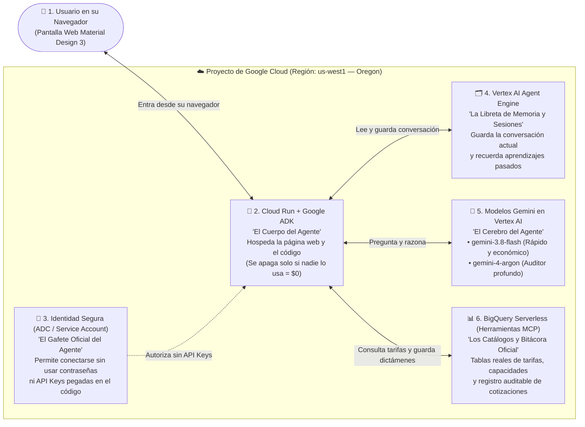
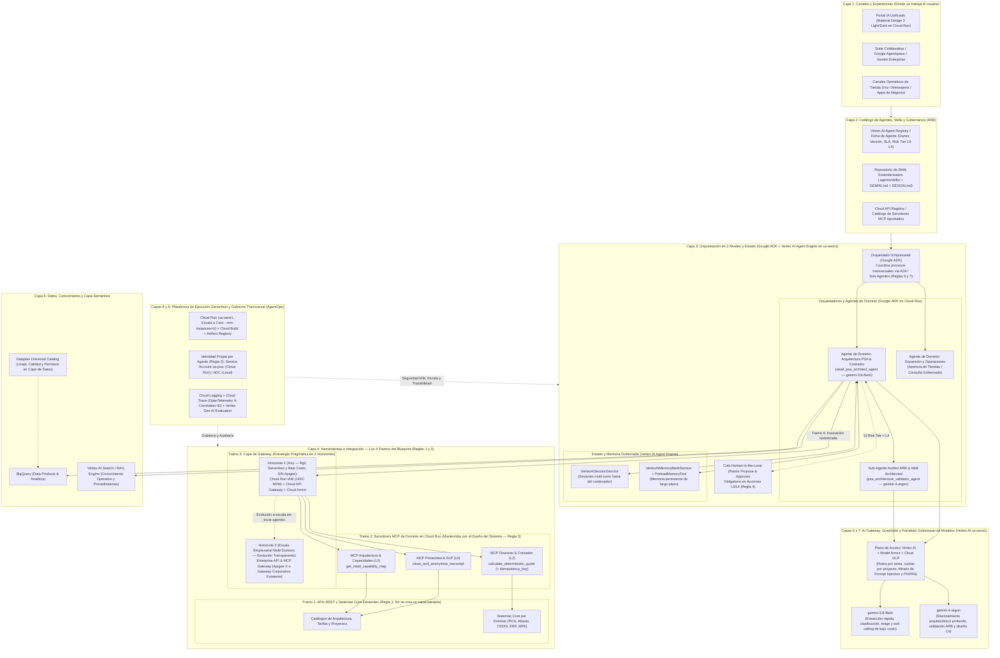

# Retail Enterprise Agent Platform — Starter Kit (Build from Scratch with Antigravity)

Este repositorio es el **Starter Kit de Skills, Sistema de Diseño y Catálogos de Dominio** para construir **desde cero y paso a paso** una solución agéntica empresarial sobre **Google Cloud Platform (Vertex AI, Google ADK, Agent Engine y Cloud Run en la región `us-west1` — Oregon)** utilizando **Google Antigravity** y la **Consola Web de GCP**.

La arquitectura y el ejercicio práctico aterrizan directamente el **Framework de la Plataforma de Interconexión IA** (sus **9 capas**, **7 reglas rectoras**, **escala de riesgo `L0–L4`**, **4 tramos de exposición MCP** y **5 patrones de orquestación**) a componentes nativos de **Google Cloud**, siguiendo las mejores prácticas del **Google Cloud Well-Architected Framework**.

---

## 🧭 1. Arquitectura en Google Cloud (De lo Simple a lo Detallado)

Para facilitar el entendimiento tanto a perfiles que están dando sus primeros pasos en **Google Cloud Platform (GCP)** como a arquitectos empresariales, presentamos la arquitectura en **dos niveles de zoom**:

### 1.1 Vista de Muy Alto Nivel: Las 6 Piezas de Nuestro Agente en GCP (Explicación Sencilla)

Si es tu primera vez trabajando en Google Cloud, solo necesitas ubicar estas **6 piezas básicas** que construiremos paso a paso en la región **`us-west1` (Oregon)**:



#### Glosario Rápido de Google Cloud (Sin Tecnicismos)

| Pieza en el Diagrama | ¿Qué es en palabras simples? | ¿Por qué la usamos en este taller? |
| :--- | :--- | :--- |
| **1. Google Antigravity + `adk` (`agent-cli`)** | Es nuestro **asistente de programación e impulsor de agentes**. En lugar de escribir miles de líneas a mano, le damos instrucciones (*prompts*) y construye el agente con el kit oficial **Google ADK**. | Para levantar el agente y su interfaz web desde cero en minutos, entendiendo cada paso. |
| **2. Cloud Run (`us-west1`)** | Es el **servidor web inteligente de Google Cloud**. Tú le entregas tu código y él te da un enlace `https://...` listo para abrir en el navegador. | Porque **escala a cero**: cuando termina la sesión y nadie está haciendo clic, se apaga automáticamente y **no cobra nada (\$0.00)**. |
| **3. ADC y Service Account (`IAM`)** | Es el **gafete electrónico de seguridad**. En tu laptop usamos tu inicio de sesión (**ADC**) y en la nube el agente tiene su propio gafete (**Service Account**). | Para **nunca usar API Keys** (llaves secretas de texto que se pueden filtrar o robar) al llamar a Gemini o a BigQuery. |
| **4. Vertex AI Agent Engine (Sesiones y Memoria)** | Es la **memoria conversacional del agente**. **Sesiones** recuerda de qué estamos hablando hoy; **Memory Bank** recuerda aprendizajes importantes para futuras conversaciones. | Para que aunque Cloud Run se apague o abras una sesión nueva mañana, el agente no pierda la memoria. |
| **5. Vertex AI (`gemini-3.8-flash` y `gemini-4-argon`)** | Es la **central de inteligencia artificial de Google Cloud**, donde viven los modelos autorizados para nuestro proyecto en **`us-west1` (Oregon)**. | Usamos `gemini-3.8-flash` para responder rápido y barato, y `gemini-4-argon` cuando necesitamos auditar arquitectura compleja. |
| **6. BigQuery (`us-west1`)** | Es la **base de datos analítica serverless de Google Cloud** (se crea en 1 segundo sin levantar servidores). | Ahí guardamos las **3 tablas reales** de cada participante (`catalogo_tarifas`, `mapa_capacidades_retail` y la bitácora `registro_dictamenes_psa` con control de idempotencia y cola `Propose & Approve`). |

---

### 1.2 Arquitectura Empresarial Objetivo Detallada (Mapeo de las 9 Capas del Blueprint de Interconexión IA a GCP)

Para el equipo de **Arquitectura Empresarial y Gobierno (ARB)**, el siguiente diagrama muestra cómo las 5 piezas anteriores se insertan dentro de las **9 capas completas del Blueprint de la Plataforma de Interconexión IA**:



---

### 💡 Nota Arquitectónica Clave: El Rol del API / MCP Gateway (Por qué NO usamos Apigee hoy, pero cómo encaja a escala)

Uno de los pilares del **Blueprint de Interconexión IA (Regla 1 y Sección 6.4 / Sección 7)** es **prohibir integraciones punto a punto sin gobierno** entre los agentes y los sistemas core. Sin embargo, conforme al pilar de **Optimización de Costos (FinOps)** y simplicidad operativa del **Google Cloud Well-Architected Framework**, adoptamos una **estrategia evolutiva en dos horizontes**:

1. **Horizonte 1 — Adopción Ágil y Ejercicio Práctico (Sin Apigee por costo y complejidad):**
   - Para arrancar y escalar los primeros casos de uso sin incurrir en el costo base de licenciamiento ni en la curva de aprovisionamiento de Apigee, implementamos los controles del Gateway utilizando componentes **100% serverless y de pago por uso** nativos en GCP:
     - **Autenticación e Identidad por Agente (Regla 2)**: **Cloud Run IAM con tokens OIDC máquina-a-máquina**, donde la Service Account dedicada del agente (`sa-psa-<participante>`) es validada criptográficamente antes de invocar cualquier servicio o herramienta.
     - **Protección Perimetral y Cuotas Ligeras**: **Cloud API Gateway** (serverless) o **Cloud Load Balancing + Cloud Armor**, junto con la validación del **Contrato Mínimo de Herramienta MCP (Sección 7.1)** (`idempotency_key`, `X-Correlation-ID` y clasificación `L0–L4`) directamente en la fachada del Servidor MCP de Dominio en Cloud Run.
2. **Horizonte 2 — Escala Empresarial Multi-Dominio (Por qué el Gateway Empresarial es un componente estratégico futuro):**
   - A medida que la organización conecte decenas de agentes a través de los **9 dominios del mapa de capacidades** (*Operaciones, Cadena de Suministro, Mercaderías, Ventas, B2C, Servicios, Administración y Finanzas, RRHH y Expansión*), el Tramo 3 requiere políticas corporativas centralizadas (cuotas cruzadas por unidad de negocio, catálogos OpenAPI/MCP corporativos, detección avanzada de anomalías y federación con terceros).
   - En ese momento, **Apigee X (o el API Gateway corporativo que la organización ya opere en producción)** se inserta en el **Tramo 3** de forma **100% transparente**: como los agentes en **Google ADK** y los **Servidores MCP de Dominio** ya respetan contratos desacoplados, **no se reescribe ni una sola línea de código del agente**.

---

## 🧩 2. Traducción del Framework Agéntico (Blueprint) a Componentes de Google Cloud

| Capa / Regla del Blueprint de Interconexión IA | Qué exige el Framework del Cliente | Componente Nativo en Google Cloud Platform (GCP) | Cómo lo construimos en este Taller con Antigravity |
| :--- | :--- | :--- | :--- |
| **Capa 1: Canales y Experiencias** *(Sección 6.1)* | Llevar el agente al usuario o a un Portal IA unificado de descubrimiento. | **Cloud Run** (Portal IA Web) + **Google Agentspace / Gemini Enterprise** | Construimos desde cero con Antigravity un **Workspace Web en Material Design 3** (Light & Dark Mode) servido por FastAPI en Cloud Run (`us-west1`). |
| **Capa 2: Catálogo de Agentes y Skills** *(Sección 6.2)* | Ningún agente llega a producción sin ficha mínima: *owner, versión, risk tier, SLA y evaluación*. | **Vertex AI Agent Registry** + Fichas `AGENT_CATALOG_CARD` + `.agents/skills/` | El agente declara su `AGENT_CATALOG_CARD` en código (`owner_squad`, `version`, `max_risk_tier: L2`, `sla`) y la expone en vivo en la barra de gobernanza de la UI. |
| **Capa 3: Orquestación en 2 Niveles y Runtime** *(Sección 6.3, 8 y 8.1 — Reglas 5 y 7)* | Separar Orquestador Empresarial de Agentes de Dominio; soportar memoria persistente y los 5 patrones (*Consulta gobernada, Ejecución acotada, Propose & approve...*). | **Google ADK (`google-adk`)** + **Vertex AI Agent Engine** (`VertexAiSessionService` y `VertexAiMemoryBankService`) + **Cloud Workflows** | Programamos en `psa_agent/agent.py` un agente coordinador (`gemini-3.8-flash`) que colabora con un sub-agente validador ARB (`gemini-4-argon`) y persiste sesiones y memoria en Vertex AI Agent Engine. |
| **Capa 4: Herramientas e Integración — Los 4 Tramos** *(Sección 6.4, 7, 7.1 y 8.2 — Reglas 1, 3 y 4)* | 1) API existente -> 2) Servidor MCP del dominio dueño -> 3) Gateway -> 4) Agente. Contrato mínimo con `L0–L4`, `idempotency_key` y frontera `L4` no autónoma. | **Servidores MCP en Cloud Run** + **Cloud Run IAM OIDC / Cloud API Gateway** *(evolucionable a Apigee / Gateway Corporativo)* | Programamos 4 herramientas con el **Contrato Mínimo 7.1** (`risk_level`, `idempotency_key`, `correlation_id`, `owner_domain`, `execution_pattern`) y bloqueo `Propose & Approve` para `L4`. |
| **Capa 5: Datos y Conocimiento** *(Sección 6.5)* | Datos como productos compartidos, capa semántica y control de acceso en la capa de datos (nunca solo en el prompt). | **BigQuery (`us-west1`)** + **Vertex AI Search / RAG Engine** + **Dataplex** | Cada participante aprovisiona su dataset aislado `psa_governance_<id>` en **BigQuery (`us-west1`)** con 3 tablas reales: `catalogo_tarifas`, `mapa_capacidades_retail` y `registro_dictamenes_psa` (donde se valida `idempotency_key` y se encola `Propose & Approve`). |
| **Capas 6 y 7: AI Gateway y Portafolio de Modelos** *(Sección 6.6 y 6.7)* | *"Portafolio, no monogamia"*: elegir el modelo por tarea y costo detrás de un plano gobernado con guardrails y DLP. | **Vertex AI Endpoints (`us-west1`)** + **Model Armor** + **Cloud Sensitive Data Protection (DLP)** | Ruteo estricto por tarea: **`gemini-3.8-flash`** para extracción/triage rápido y **`gemini-4-argon`** para auditoría arquitectónica compleja, más limpieza local de PII/PAN previa al LLM. |
| **Capas 8 y 9: Ejecución, Identidad y Observabilidad** *(Sección 6.9, 6.10 y 12 — Regla 2)* | Identidad propia por agente (cero credenciales humanas o genéricas), trazabilidad `X-Correlation-ID` y control FinOps. | **Cloud Run** (`--min-instances=0`) + **IAM Service Accounts dedicadas** (`sa-psa-<id>`) + **ADC** + **Cloud Logging & Cloud Trace** | Modelo IAM de 3 niveles en la Consola de GCP, autenticación local con `gcloud auth application-default login` (cero API keys) y trazas de tool calls en pantalla. |

---

## 🏅 3. Alineación al Google Cloud Well-Architected Framework (5 Pilares + Perspectiva AI/ML)

Todo lo que los participantes construyen durante el taller aplica directamente los **5 pilares del Google Cloud Well-Architected Framework**:

| Pilar Well-Architected | Buenas Prácticas de Google Cloud Aplicadas en el Ejercicio | Regla / Sección del Blueprint que Resuelve |
| :--- | :--- | :--- |
| **1. Seguridad, Privacidad y Cumplimiento** | • **Cero API Keys y Cero Llaves JSON**: Uso exclusivo de **ADC** en entorno local y **Service Accounts dedicadas por agente** (`sa-psa-<participante>`) en Cloud Run.<br>• **IAM de 3 Niveles con Mínimo Privilegio**: Separación entre Admin del Proyecto, Desarrollador (con `Service Account User` solo sobre su propia SA) e Identidad del Agente.<br>• **Minimización de Datos (Privacy-by-Design)**: Redacción determinista de `PAN`, correos y teléfonos antes de invocar a Vertex AI. | • **Regla 2** (Identidad propia y permisos mínimos).<br>• **Regla 4** (Acciones críticas `L4` nunca autónomas).<br>• **Sección 7.1 y 9** (Escala de riesgo `L0–L4` y redacción de datos sensibles). |
| **2. Confiabilidad (Reliability)** | • **Cómputo Stateless + Estado Externalizado**: El contenedor en Cloud Run no guarda sesiones en memoria RAM local; delega a `VertexAiSessionService` y `VertexAiMemoryBankService` (con fallback resiliente en desarrollo).<br>• **Idempotencia Transaccional**: Toda herramienta `L2–L4` exige `idempotency_key` y propaga `correlation_id`. | • **Sección 8.2** (Control transaccional e idempotencia).<br>• **Sección 12.1** (Mitigación de operaciones duplicadas y pérdida de trazabilidad). |
| **3. Optimización de Costos (FinOps)** | • **Arquitectura Serverless Escala a Cero**: Cloud Run con `--min-instances=0` (\$0 costo en reposo) y estrategia de Gateway sin licenciamiento base de Apigee en fase inicial.<br>• **FinOps de Modelos y Código Determinista**: Uso de Python determinista para cálculos matemáticos (`/quote`) en vez de gastar tokens del LLM, y ruteo entre `gemini-3.8-flash` y `gemini-4-argon`.<br>• **Etiquetado y Decommission**: Labels `workshop=psa-agent-lab,participant=<id>` y apagado total en consola al finalizar. | • **Sección 6.3** (*"Si el flujo es determinista, código es más barato y auditable que un LLM"*).<br>• **Sección 6.6, 6.7 y 12.2** (Control de costo por agente y prevención de *agent sprawl*). |
| **4. Excelencia Operativa (AgentOps)** | • **Desarrollo Estandarizado por Contratos y Skills**: Uso de `.agents/skills/`, `GEMINI.md` y `DESIGN.md` para que todos los equipos construyan bajo el mismo estándar del ARB.<br>• **Ficha de Catálogo (`AGENT_CATALOG_CARD`) y Trazas**: Visibilidad en tiempo real de qué herramienta se invocó, con qué nivel de riesgo (`L0–L4`) y bajo qué patrón de orquestación. | • **Sección 6.2** (Catálogo de agentes y ficha mínima).<br>• **Sección 10.1** (Gobierno del AI Architecture Board / ARB y AgentOps). |
| **5. Eficiencia en el Rendimiento (Performance)** | • **Selección Regional por Capacidad (`us-west1` — Oregon)**: Despliegue unificado de cómputo y modelos en Oregon para garantizar disponibilidad de cuota y baja latencia.<br>• **Higiene de Contexto con `PreloadMemoryTool`**: Se recuperan únicamente recuerdos relevantes desde `VertexAiMemoryBankService`. | • **Sección 2 y 6.7** (Baja latencia operativa y memoria persistente curada). |

---

## 📦 4. Estructura de este Starter Kit (Sin Código Preconstruido ni Scripts Ocultos)

Al clonar este repositorio encontrarás **únicamente los cimientos** para que cada participante construya su propio agente desde cero con **Antigravity** y la **Consola Web de GCP**:

```text
retail-agent-platform-starter/
├── GEMINI.md                                      # Gobernanza IA: Blueprint 9 capas + GCP Well-Architected (us-west1, gemini-3.8-flash y gemini-4-argon, cero API keys)
├── DESIGN.md                                      # Sistema de Diseño Material Design 3 (Light & Dark Mode, Rojo #C8102E y Oro #F6A800)
├── .agents/
│   └── skills/                                    # 5 Skills especializados que guían a Antigravity paso a paso:
│       ├── retail-material-design/SKILL.md        #   1. UI Material Design 3 con temas claro/oscuro, tarjetas PSA/Quote y fichas de gobierno
│       ├── psa-solution-architect/SKILL.md        #   2. Reglas de /psa, /quote, Apertura PFERNANDEZ, Orquestación 2 niveles y Well-Architected
│       ├── adk-platform-scaffolder/SKILL.md       #   3. Google ADK + AGENT_CATALOG_CARD (Sección 6.2) + VertexAiSessionService / MemoryBank
│       ├── mcp-domain-wrapper/SKILL.md            #   4. Los 4 tramos MCP, Contrato Mínimo 7.1 (L0-L4, idempotencia, correlación) y Gateway pragmático
│       └── cloudrun-iam-deployer/SKILL.md         #   5. IAM de 3 niveles, aislamiento PARTICIPANT_ID, escala a cero y FinOps
└── data/                                          # Catálogos de referencia e insumos reales de los 9 dominios del negocio:
    ├── mapa_capacidades_retail.json               #   Los 9 dominios oficiales del Blueprint + reglas Sección 5.2 (Infra) vs 5.4 (Redes/Gateway)
    ├── catalogo_tarifas.json                      #   Catálogo determinista de tarifas mensuales, bolsas y costos únicos (MXN)
    └── ejemplos_minutas.json                      #   3 casos reales: /psa Conciliación POS, /quote Estimación y Apertura de Tiendas PFERNANDEZ
```

---

## 🚀 5. Ruta Paso a Paso en la Consola Web de GCP y Prompts en Antigravity (Región `us-west1` — Oregon)

### Fase 0 — Administrador del Proyecto en la Consola Web de GCP (`console.cloud.google.com`)
1. **Habilitar APIs** (*APIs & Services > Library*): Habilitar `Vertex AI API`, `BigQuery API`, `Cloud Run Admin API`, `Cloud Build API`, `Artifact Registry API` e `Identity and Access Management (IAM) API`.
2. **Crear Service Account por Participante — Regla 2 del Blueprint** (*IAM & Admin > Service Accounts > Create Service Account*):
   - Nombre: `sa-psa-<participante>` (ej. `sa-psa-jperez`).
   - Roles en el proyecto para esta Service Account (**Nivel 3 — Mínimo Privilegio**): `Vertex AI User`, `BigQuery Data Editor`, `BigQuery Job User`, `Logs Writer`, `Cloud Trace Agent` (**sin crear ni descargar llaves JSON**).
   - En el **Paso 3 (Grant users access to this service account)**, agregar el correo del participante (`jperez@empresa.com`) en **Service account users role** (`roles/iam.serviceAccountUser`) para que solo pueda desplegar usando su propia Service Account.
3. **Otorgar Roles de Desarrollador al Participante — Nivel 2** (*IAM & Admin > IAM > Grant Access*):
   - Principal: correo del participante.
   - Roles: `Vertex AI User`, `BigQuery Data Editor`, `BigQuery Job User`, `Cloud Run Developer`, `Cloud Build Editor`, `Artifact Registry Writer`, `Service Usage Consumer` y `Logs Viewer` (**sin `Owner`, `Editor` ni `Project IAM Admin`**).

---

### Fase 1 — Clonar el Starter Kit y Configurar Identidad Local ADC con Antigravity (Pilar de Seguridad)
1. Clona este repositorio y ábrelo en **Antigravity**:
   ```bash
   git clone https://github.com/berryrreb/retail-agent-platform-starter.git
   cd retail-agent-platform-starter
   agy .
   ```
2. **Prompt #1 en Antigravity (Configurar ADC sin API Keys y `.env` aislado en `us-west1` — Oregon)**:
   > *"Hola Antigravity. Vamos a iniciar el ejercicio práctico siguiendo el Blueprint de Interconexión IA y el Google Cloud Well-Architected Framework. Mi proyecto de GCP es `<TU_PROJECT_ID>`, la región es `us-west1` (Oregon) y mi identificador de participante es `<TU_PARTICIPANT_ID>`. Ayúdame paso a paso a: 1) Revisar mi cuenta activa en gcloud y autenticar mis Application Default Credentials (ADC) con `gcloud auth application-default login` y `set-quota-project`; 2) Crear mi archivo `.env` con `GOOGLE_GENAI_USE_VERTEXAI=TRUE`, `GOOGLE_CLOUD_LOCATION=us-west1`, `PARTICIPANT_ID`, `BQ_DATASET=psa_governance_<TU_PARTICIPANT_ID>`, `MODEL_FAST=gemini-3.8-flash` y `MODEL_REASONING=gemini-4-argon`; y 3) Explicarme cómo ADC en local y las Service Accounts en Cloud Run cumplen la Regla 2 del Blueprint sin usar ninguna API Key."*

---

### Fase 2 — Crear el Dataset en BigQuery (`us-west1`) y Construir el Agente con `adk` (`agent-cli`) y Antigravity
1. **Prompt #2 en Antigravity (Inicializar entorno, poblar las 3 tablas reales en BigQuery `us-west1` y crear esqueleto ADK)**:
   > *"Usando los skills `@adk-platform-scaffolder` y `@psa-solution-architect`, ayúdame a: 1) Crear `requirements.txt` (`google-adk`, `google-genai`, `google-cloud-bigquery`, `fastapi`, `uvicorn[standard]`, `pydantic`, `python-dotenv`), crear `.venv` e instalar dependencias; 2) Crear en BigQuery (región `us-west1` Oregon) mi dataset aislado `psa_governance_<TU_PARTICIPANT_ID>` con las 3 tablas reales (`catalogo_tarifas` y `mapa_capacidades_retail` pobladas desde `./data/`, más la tabla de auditoría `registro_dictamenes_psa`); y 3) Inicializar el paquete `psa_agent/` compatible con `adk web` y `adk run`, incluyendo la ficha de gobierno `AGENT_CATALOG_CARD` de la Sección 6.2 del Blueprint."*
2. **Prompt #3 en Antigravity (Programar las 4 Herramientas con Contrato MCP 7.1 conectadas a BigQuery y la Orquestación en 2 Niveles)**:
   > *"Usando los skills `@psa-solution-architect`, `@mcp-domain-wrapper` y `@adk-platform-scaffolder`, programa `psa_agent/agent.py` conectando las herramientas a mi dataset de BigQuery `psa_governance_<TU_PARTICIPANT_ID>` en `us-west1`: 1) Implementa las 4 herramientas deterministas (`clean_and_anonymize_transcript`, `get_retail_capability_map` leyendo la tabla `mapa_capacidades_retail` en BigQuery, `calculate_deterministic_quote` leyendo `catalogo_tarifas` en BigQuery, verificando `idempotency_key` y guardando el resultado y el estatus `Propose & Approve` en `registro_dictamenes_psa`, y `load_sample_case`) devolviendo los metadatos del Contrato Mínimo MCP 7.1; 2) Crea el sub-agente validador del ARB y Well-Architected Framework `psa_architecture_validator_agent` con `gemini-4-argon` (cuidando que en Sección 5.4 Redes se use Cloud Run IAM OIDC + Cloud API Gateway / Cloud Armor en fase inicial sin el costo de Apigee, dejando el Enterprise Gateway como evolución a escala, y aplicando el patrón Propose & Approve en nivel L4); y 3) Crea el agente coordinador raíz `retail_psa_architect_agent` (`root_agent`) con `gemini-3.8-flash` y `PreloadMemoryTool()`."*
3. **Prompt #4 en Antigravity (Validar el agente y su conexión a BigQuery con el CLI `adk`)**:
   > *"Ejecuta una prueba rápida con `adk` para verificar que nuestro agente carga sin errores con mis credenciales ADC locales en `us-west1`, consulta mi dataset en BigQuery y respeta el contrato MCP y los modelos `gemini-3.8-flash` y `gemini-4-argon`."*

---

### Fase 3 — Sesiones y Memoria Persistente 100% Reales en Vertex AI Agent Engine (`us-west1` — Oregon)
1. **En la Consola Web de GCP**: Abre **Vertex AI > Agent Engine** (selecciona la región **`us-west1` — Oregon**).
2. **Prompt #5 en Antigravity (Aprovisionar Agent Engine y construir el Backend FastAPI)**:
   > *"Usando `@adk-platform-scaffolder`, ayúdame a: 1) Crear mi instancia aislada de Vertex AI Agent Engine llamada `psa-engine-<TU_PARTICIPANT_ID>` en `us-west1` (Oregon) y guardar su `AGENT_ENGINE_ID` en mi `.env`; y 2) Construir desde cero `main.py` con FastAPI conectando directamente `VertexAiSessionService` y `VertexAiMemoryBankService` contra mi `AGENT_ENGINE_ID` real en `us-west1` (sin mocks en memoria) y exponiendo `/api/config` (incluyendo `AGENT_CATALOG_CARD`), `/api/samples`, `/api/sessions`, `/api/memories`, `/api/memory/consolidate` y `/api/chat`."*

---

### Fase 4 — Construir la Interfaz Web Material Design 3 (Light & Dark Mode) desde Cero
1. **Prompt #6 en Antigravity (Generar la Interfaz Web Material Design 3 y levantar servidor local)**:
   > *"Usando el skill `@retail-material-design` y siguiendo estrictamente `DESIGN.md`, construye desde cero la interfaz web en `static/index.html`, `static/styles.css` y `static/app.js` con soporte de Tema Claro y Tema Oscuro, paleta institucional Rojo `#C8102E` y Amarillo Oro `#F6A800`, barra superior con los metadatos de la Ficha de Catálogo del Agente (Sección 6.2), botones de carga rápida para `/psa`, `/quote` y `Apertura de Tiendas PFERNANDEZ`, chips de trazabilidad MCP (`risk_level`, `execution_pattern`, `correlation_id`), tarjetas de alineación al Blueprint y al Google Cloud Well-Architected Framework, diagramas C4 en Mermaid, tablas financieras con `tabular-nums` e inspector de Sesiones y Memoria. Al terminar, levanta el servidor en el puerto 8080."*

---

### Fase 5 — Despliegue Serverless en Cloud Run (`us-west1` — Oregon) con Identidad Propia
1. **Prompt #7 en Antigravity (Crear `Dockerfile` y desplegar a Cloud Run con Service Account dedicada)**:
   > *"Usando el skill `@cloudrun-iam-deployer`, genera el `Dockerfile` desde cero y despliega mi agente en Cloud Run en la región `us-west1` (Oregon) bajo el nombre `psa-agent-<TU_PARTICIPANT_ID>`, asociando mi cuenta de servicio dedicada `sa-psa-<TU_PARTICIPANT_ID>@<TU_PROJECT_ID>.iam.gserviceaccount.com` (Regla 2 del Blueprint), con escala a cero (`--min-instances=0`), etiquetas FinOps (`workshop=psa-agent-lab,participant=<TU_PARTICIPANT_ID>`) y las variables de entorno de Vertex AI y BigQuery (`GOOGLE_CLOUD_LOCATION=us-west1`, `BQ_DATASET=psa_governance_<TU_PARTICIPANT_ID>`, `gemini-3.8-flash` y `gemini-4-argon`)."*
2. **En la Consola Web de GCP (`console.cloud.google.com/run`)**: Entra a tu servicio `psa-agent-<TU_PARTICIPANT_ID>` (`us-west1`) y revisa las pestañas **Security** (Service Account dedicada), **Variables & Secrets** (cero API keys) y **Scaling** (`min-instances = 0`).

---

### Fase 6 — Laboratorio de Pruebas End-to-End en Cloud Run y BigQuery (`us-west1`) Antes de Limpiar

Una vez desplegado tu servicio en Cloud Run, abre la URL pública `https://psa-agent-<TU_PARTICIPANT_ID>-...us-west1.run.app` en tu navegador y ejecuta estos **6 escenarios de prueba** para demostrar cada pieza de arquitectura construida:

| # | Escenario de Prueba | Qué hacer en el Portal Web Desplegado y en GCP | Qué demuestra de la Arquitectura que Construimos |
| :--- | :--- | :--- | :--- |
| **1** | **Proceso Transversal Multi-Dominio y Estrategia de Gateway** (*Caso Apertura de Tiendas `PFERNANDEZ`*) | Haz clic en el botón rápido **`Caso 1: Apertura de Tiendas PFERNANDEZ`** y revisa las pestañas **Documento PSA** y **Diagramas C4 (Mermaid)**. | • **DLP Preventivo (`L0`)**: `clean_and_anonymize_transcript` redacta correos y teléfonos antes de llegar al LLM.<br>• **Consulta en BigQuery (`L0`)**: `get_retail_capability_map` lee la tabla `mapa_capacidades_retail` en BigQuery (`us-west1`) cruzando *Expansión, Cadena de Suministro, Mercaderías y Operaciones*.<br>• **Regla Anti-Invención ARB**: Deja vacíos el **Folio** y los **4 roles de la Sección 1** no mencionados en la minuta y marca las recomendaciones con chips ámbar **`⟨propuesto: …⟩`**.<br>• **Sección 5.2 vs. 5.4 y Gateway en 2 Horizontes**: Separa Infraestructura (`Cloud Run` + `Agent Engine` + `BigQuery` en `us-west1`) de Redes (Horizonte 1 con **Cloud Run IAM OIDC + Cloud API Gateway + Cloud Armor** sin costo base de Apigee; Horizonte 2 con **Enterprise API/MCP Gateway** a escala). |
| **2** | **Frontera de Riesgo `L4` (`Propose & Approve`), Redacción de Tarjetas `PAN` y Roles `TBD`** (*Caso Conciliación*) | Haz clic en el botón rápido **`Caso 2: Conciliación Asistida (Frontera L4)`** y revisa el dictamen de gobernanza y la pestaña **Cotización Determinista (`/quote`)**. | • **Protección PCI (`L0`)**: Enmascara la tarjeta `4532 0151 1283 9901` como `[TARJETA_PAN_REDACTADA]`.<br>• **Regla 4 del Blueprint (`Risk Tier L4`)**: `gemini-4-argon` detecta afectación contable en ERP/MPE, exige **`Propose & Approve`** y registra el folio en la tabla `registro_dictamenes_psa` de BigQuery con estatus **`PENDING_HUMAN_APPROVAL_L4`**.<br>• **Honestidad en Tarifas (`L2`)**: Lee `catalogo_tarifas` en BigQuery y marca al **`Especialista SAP FI`** como **`TBD` / `⟨propuesto: Rol fuera de catálogo⟩`** sin inventar precios. |
| **3** | **Prueba Anti-Alucinación Matemática e Idempotencia Real en BigQuery (`/quote` Puro)** | Copia y pega en el chat:<br>`/quote Cotiza el proyecto "Agente de Control de Merma y Cadena de Frío" por 4 meses con: 1 Arquitecto de Soluciones al 50%, 1 AI Engineer al 100%, 1 Data & Knowledge Steward al 100%, 1 Ingeniero IoT de Refrigeración al 100%, más $80,000 MXN únicos de pruebas de campo.` | • **FinOps e Idempotencia en BigQuery (Secciones 6.3 y 8.2)**: `calculate_deterministic_quote` verifica primero `idempotency_key` en `registro_dictamenes_psa`, lee `catalogo_tarifas` en BigQuery y calcula sin error en Python: **`$212,000 MXN`** (Mensual Recurrente), **`$2,544,000 MXN`** (Anual Run-Rate = Mensual × 12) y **`$928,000 MXN`** (Total a 4 meses + one-off), aislando al *Ingeniero IoT* como `TBD`. |
| **4** | **Sesiones Multi-Turno y Memoria Persistente entre Sesiones en `us-west1`** | 1. Haz clic en **`Caso 3: Iteración en Sesión + Memory Bank`**.<br>2. Haz clic en **"Guardar en Memoria LP"**.<br>3. Abre **"+ Nueva Sesión"** (chat en blanco) y pregunta:<br>`¿Qué reglas permanentes de nuestro comité ARB recuerdas de sesiones anteriores y cómo aplican a un agente entre Mercaderías y Abasto?` | • **Confiabilidad Well-Architected**: Comprueba que **`VertexAiSessionService`** mantiene el contexto multi-turno y que **`VertexAiMemoryBankService` + `PreloadMemoryTool()`** recuerdan los estándares del comité ARB en una sesión nueva aunque el contenedor de Cloud Run sea *stateless*. |
| **5** | **Auditoría ARB de una Minuta con Malas Prácticas (Violación a Reglas 1, 2 y 4 del Blueprint)** | Copia y pega en el chat esta minuta hipotética para que el Arquitecto PSA la audite:<br>`/psa [MINUTA A EVALUAR] El área solicitante propone diseñar un proyecto donde su agente se integre punto a punto con el sistema interno de cajas sin usar servidores MCP ni Gateway, aplique reembolsos financieros automáticos en tarjeta sin revisión humana y se autentique con una API Key fija en el código.` | • **Auditoría ARB con `gemini-4-argon`**: El Sub-Agente Auditor evalúa el documento `/psa` y señala las **3 violaciones al Blueprint**:<br>1) **Regla 1**: Prohibida la integración punto a punto creando un canal paralelo (debe usar API REST -> MCP -> Gateway).<br>2) **Regla 2**: Prohibido usar API Keys (debe usar Service Account + ADC).<br>3) **Regla 4**: Reembolsos son **`L4`**, prohibida la ejecución autónoma. |
| **6** | **Verificación de Registros en BigQuery Studio y Trazas (`X-Correlation-ID`) en Cloud Run** | 1. Abre **BigQuery Studio** (`console.cloud.google.com/bigquery`), entra a `psa_governance_<TU_PARTICIPANT_ID>.registro_dictamenes_psa` y consulta los dictámenes guardados.<br>2. En **Cloud Run (`us-west1`) > LOGS**, filtra por el `correlation_id` del chip MCP. | • **Capa 5 (Datos) + Excelencia Operativa (AgentOps)**: Comprueba en BigQuery las filas insertadas por la Service Account `sa-psa-<TU_PARTICIPANT_ID>` (con `idempotency_key`, `correlation_id` y estatus `PENDING_HUMAN_APPROVAL_L4`) y su traza correlacionada en Cloud Logging. |

---

### Fase 7 — Limpieza Total de Recursos al Finalizar (FinOps — \$0 Costo Residual)
- Desde la **Consola Web de GCP** (*Cloud Run > Delete*, *BigQuery > Delete dataset `psa_governance_<TU_PARTICIPANT_ID>`* y *Vertex AI > Agent Engine (`us-west1`) > Delete*) o con el **Prompt #8 en Antigravity**:
  > *"Ayúdame a eliminar en `us-west1` mi servicio Cloud Run `psa-agent-<TU_PARTICIPANT_ID>`, mi dataset de BigQuery `psa_governance_<TU_PARTICIPANT_ID>` y mi instancia de Agent Engine `psa-engine-<TU_PARTICIPANT_ID>`, y verifica que no quede ningún recurso mío generando costos en el proyecto."*
